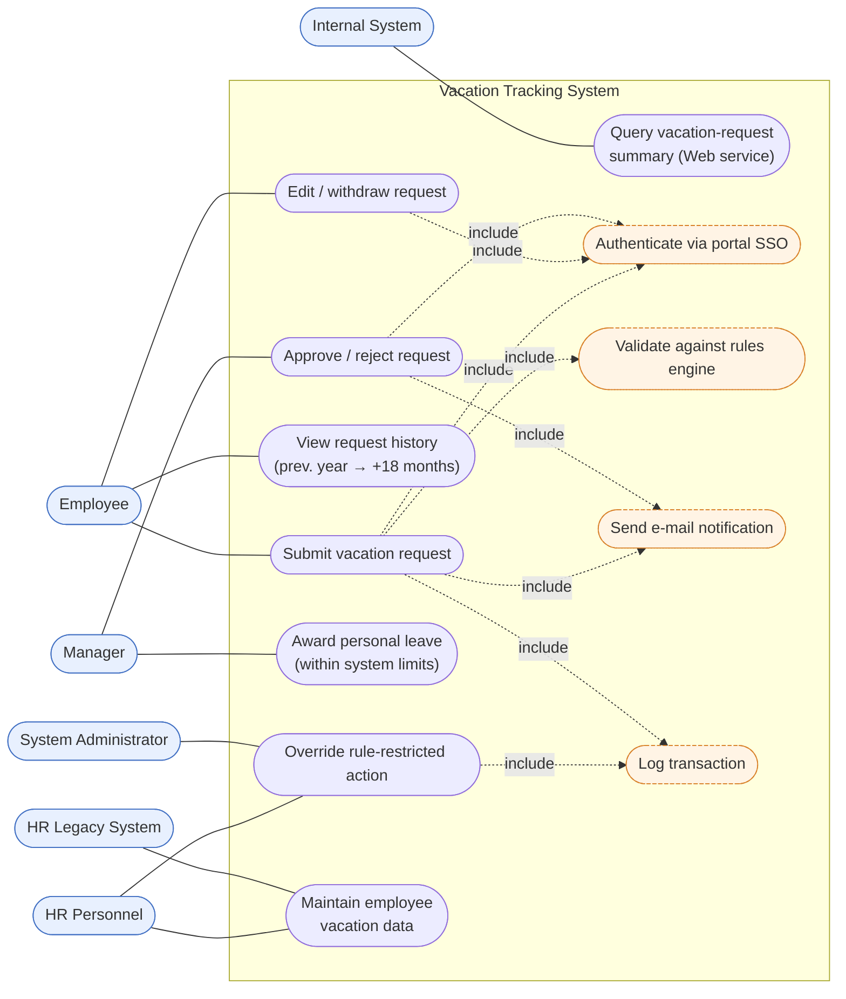

# Use-Case Diagram — Vacation Tracking System

**Source of record:** [Lucidchart](https://lucid.app/lucidchart/d8e7b2e5-89a3-411d-9695-0f945f7aff0f/edit)

Shows **who** uses the VTS and **what** they can do. Mermaid has no native UML
use-case notation, so actors are rendered as `([actor])` nodes outside a system
boundary (the subgraph), with use cases as rounded nodes inside. `«include»`
dependencies (SSO auth, rules validation, logging, e-mail) are dashed, following
UML convention — these behaviours are pulled into many use cases rather than
triggered directly by an actor.

## Actors

| Actor | Role |
|-------|------|
| **Employee** | Submits, edits, withdraws, and reviews their own leave requests. |
| **Manager** | Optionally approves/rejects requests; may award personal leave within limits. |
| **HR Personnel** | Maintains employee vacation data; may override rule-restricted actions (logged). |
| **System Administrator** | May override rule-restricted actions (logged). |
| **HR Legacy System** | External system supplying/receiving employee information. |
| **Internal System** | External consumer of the vacation-summary Web service. |
