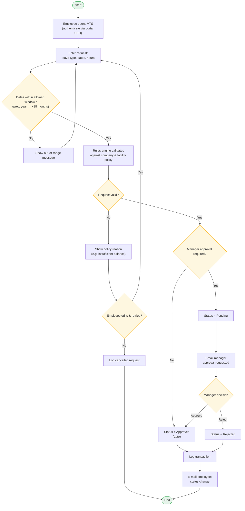

# Flowchart — Submit a New Vacation Request

**Source of record:** [Lucidchart](https://lucid.app/lucidchart/8b88e3e0-78ac-4eeb-a3b5-63b824c1d8e3/edit)

The core domain journey: *the employee wishes to submit a new request for vacation
time.* Follows flowchart best practice — one start and one end terminator, every
decision is a diamond with labelled Yes/No exits, and the rules engine / optional
manager approval / e-mail / logging requirements from the spec are shown explicitly.

## Notes

- **Rules engine (NFR1).** All validation is centralised — the employee never needs
  to know the policy; the engine enforces it.
- **Optional approval (F1).** When approval is not required, the request is
  auto-approved; the Yes branch covers the manager-approval path.
- **E-mail (F3)** is sent both to request manager approval and to notify the
  employee of any status change.
- **Logging (F6)** happens on every terminal outcome — approved, rejected, or
  cancelled.
