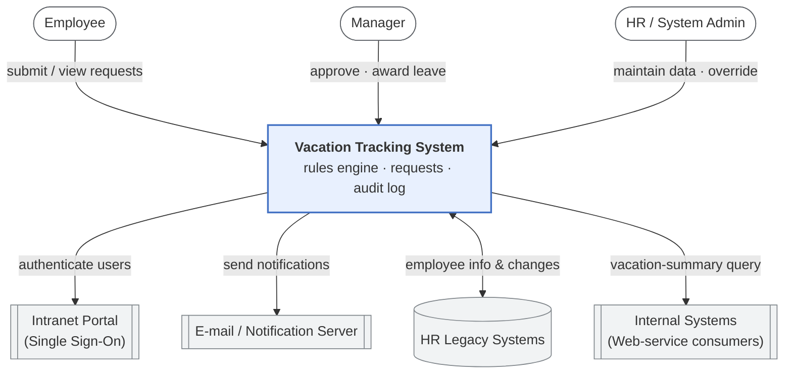

# System Context Diagram — Vacation Tracking System

**Source of record:** [Lucidchart](https://lucid.app/lucidchart/d45b8374-fe33-4ad1-95e8-91574aae2253/edit)

Places the VTS in its environment: the people who use it and the external systems
it depends on or serves. This reflects the integration constraints in the spec —
VTS is an **extension of the existing intranet portal** (F5), reuses existing
infrastructure (F4), and talks to e-mail, the HR legacy systems, and internal
consumers over a Web service (F3/F9/F10).

## External dependencies

| System | Direction | Purpose |
|--------|-----------|---------|
| **Intranet Portal (SSO)** | VTS → Portal | All authentication; VTS is an extension of the portal (F5). |
| **E-mail Server** | VTS → E-mail | Approval requests and status-change notifications (F3). |
| **HR Legacy Systems** | VTS ↔ Legacy | Retrieve/receive employee information and changes (F10). |
| **Internal Systems** | VTS → Consumers | Serve vacation-request summaries via Web service (F9). |
